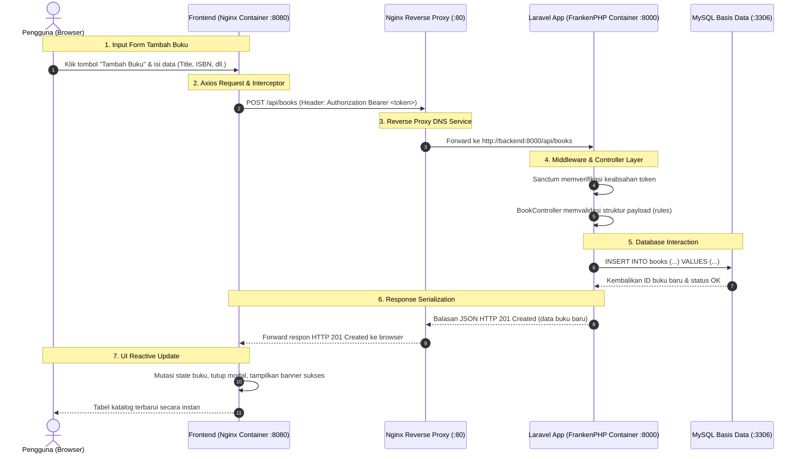

# LAPORAN UJIAN TENGAH SEMESTER (UTS)
## KONSTRUKSI DAN EVOLUSI PERANGKAT LUNAK (KEPL)

---

### **Identitas Mahasiswa**
- **Nama Lengkap** : Muhammad Arief Andriansyah
- **NIM** : 24/545740/SV/25748
- **Program Studi** : Sarjana Terapan Teknologi Rekayasa Perangkat Lunak (TRPL)
- **Departemen** : Teknik Elektro dan Informatika (TEDI)
- **Fakultas / Sekolah** : Sekolah Vokasi, Universitas Gadjah Mada
- **Tahun Akademik** : 2026 / Genap

---

### **Tautan Repositori & Bukti CI/CD**
- **URL Repositori GitHub** : `https://github.com/KEPL2026/uts-pl-24-545740-SV-25748`  
  *(Atau repositori personal: `https://github.com/muhammadariefand/uts-pl-24-545740-SV-25748`)*
- **Tautan GitHub Actions Workflow** : `https://github.com/KEPL2026/uts-pl-24-545740-SV-25748/actions`
- **Tautan GitHub Packages (GHCR)** : `https://github.com/KEPL2026/uts-pl-24-545740-SV-25748/pkgs/container/uts-backend` dan `uts-frontend`

---

## 1. Pembahasan Soal 1: Backend Laravel RESTful API (CPMK 1 - Nilai 15)

### A. Tema Aplikasi & Perancangan Resource
Untuk memenuhi ketentuan tema bebas yang berbeda dari tugas praktikum sebelumnya (yang berfokus pada item profil generik), pada UTS ini dirancang sistem **Manajemen Katalog Buku Perpustakaan (*Library Management System*)**. Resource utama yang disediakan adalah `books` dengan atribut:
- `id` (Big Integer, Primary Key Auto Increment)
- `title` (String, required): Judul buku
- `author` (String, required): Nama penulis buku
- `isbn` (String, required, unique): Nomor standar buku internasional
- `category` (String, required): Kategori bidang (Software Engineering, Computer Science, dll.)
- `published_year` (Integer, required): Tahun penerbitan buku
- `stock` (Integer, required, default 0): Jumlah stok fisik buku
- `description` (Text, nullable): Ringkasan informasi buku
- `created_at` & `updated_at` (Timestamps)

### B. Otentikasi Token dengan Laravel Sanctum
Otentikasi diimplementasikan menggunakan paket resmi **Laravel Sanctum**:
1. Endpoint login publik: `POST /api/login` menerima `email` dan `password`. Jika kredensial cocok, Sanctum menghasilkan token akses `plainTextToken` dan dikembalikan ke klien dengan status **200 OK**. Jika kredensial salah, dikembalikan status **401 Unauthorized**. Jika format input kosong/salah, dikembalikan status **422 Unprocessable Content**.
2. Endpoint logout terproteksi: `POST /api/logout` dengan middleware `auth:sanctum` menghapus token pengguna yang sedang aktif dari tabel `personal_access_tokens` dan mengembalikan respon **200 OK**.
3. Endpoint profil pengguna: `GET /api/user` dengan middleware `auth:sanctum` menyajikan data identitas pengguna yang sedang login (**200 OK**).
4. Seluruh endpoint selain login diwajibkan menyertakan header `Authorization: Bearer <token>`. Jika permintaan datang tanpa token atau token tidak valid, Laravel secara otomatis membalas dengan status **401 Unauthorized** berformat JSON: `{"message": "Unauthenticated."}`.

### C. Operasi CRUD Lengkap & Status HTTP Presisi
Pengendali `BookController` menyediakan 5 fungsi RESTful dengan kode status HTTP yang tepat:
- **Tampil Semua Data (`GET /api/books`)**: Mengembalikan daftar buku dalam format JSON berstatus **200 OK**.
- **Tambah Data (`POST /api/books`)**: Memvalidasi seluruh masukan dan menyimpan data baru ke tabel `books`. Mengembalikan data buku yang berhasil dibuat dengan kode status **201 Created**.
- **Tampil Satu Data (`GET /api/books/{id}`)**: Mengembalikan detail data buku yang dipilih (**200 OK**), atau status **404 Not Found** jika ID tidak ditemukan.
- **Ubah Data (`PUT /api/books/{id}`)**: Memvalidasi perubahan (termasuk aturan keunikan ISBN dengan mengecualikan ID buku saat ini) dan memperbarui basis data (**200 OK**).
- **Hapus Data (`DELETE /api/books/{id}`)**: Menghapus data buku dan mengembalikan respon sukses JSON (**200 OK**).
- **Validasi Gagal**: Seluruh permintaan `POST` dan `PUT` dengan data tidak lengkap atau tidak valid mengembalikan rincian error per-atribut dengan kode status **422 Unprocessable Content**.

### D. Pengujian Otomatis (Feature Tests Laravel)
Dibuat dua buah kelas pengujian fitur (*Feature Test*) menggunakan PHPUnit:
1. `tests/Feature/AuthApiTest.php` menguji skenario login valid (200), login salah (401), validasi form login (422), akses profil dengan token (200), proteksi tanpa token (401), dan penghapusan token saat logout (200).
2. `tests/Feature/BookApiTest.php` menguji penolakan akses tanpa token (401), pengambilan daftar buku (200), pembuatan buku baru (201), penolakan duplikasi ISBN (422), pengambilan satu buku (200 & 404), pembaruan data buku (200), dan penghapusan buku dari database (200).

Hasil eksekusi `php artisan test`:
```text
Pass: 17 passed (73 assertions)
Duration: 0.82s
```
*Seluruh 17 pengujian fitur berhasil lulus 100%.*

### E. Postman Collection
Seluruh endpoint API telah diekspor ke dalam berkas `UTS_KEPL_API.postman_collection.json` dan disimpan di direktori akar repository maupun folder `backend/`. Postman Collection ini dilengkapi skrip otomatis (*Tests Script*) yang secara langsung menyimpan token hasil login ke dalam *collection variable* `{{token}}`, sehingga pengujian endpoint berikutnya dapat langsung dijalankan tanpa *copy-paste* token manual.

---

## 2. Pembahasan Soal 2: Frontend Vue.js (CPMK 1 - Nilai 10)

Frontend dibangun sebagai *Single Page Application* (SPA) menggunakan **Vue 3 (Composition API `<script setup>`)**, **Vite**, **Vue Router**, dan **Axios**.

### A. Fitur Halaman Login & Pengelolaan Token
- Berada pada rute `/login`.
- Form login interaktif dengan validasi *client-side* dan penanganan error responsif (*alert banner*).
- Disediakan tombol jalan pintas "*Isi Akun Demo*" untuk mengisi kredensial default seeder (`admin@example.com` / `password123`).
- Setelah menerima respon sukses dari backend, token disimpan di `localStorage.setItem('token', token)` dan identitas pengguna disimpan di `localStorage.setItem('user', JSON.stringify(user))`.
- Dilengkapi dengan *Navigation Guard* pada Vue Router: jika pengguna belum login dan mencoba membuka halaman `/`, otomatis dialihkan ke `/login`.

### B. Halaman Manajemen Koleksi Buku (CRUD dengan Axios)
- Berada pada rute `/` dengan proteksi autentikasi.
- **Tampil Data**: Mengambil data katalog via `apiClient.get('/books')` dan menyajikannya dalam tabel modern dengan fitur *search filter real-time*, ringkasan statistik (total judul, total eksemplar stok, dan variasi kategori).
- **Tambah Data**: Tombol `+ Tambah Buku` membuka modal form yang mengirim data ke `POST /api/books` via Axios. Pesan validasi 422 ditampilkan tepat di bawah masing-masing input.
- **Ubah Data**: Tombol `Edit` membuka modal dengan data buku yang telah terisi (*pre-filled*), lalu mengirimkan permintaan `PUT /api/books/{id}`.
- **Hapus Data**: Tombol `Hapus` memunculkan dialog konfirmasi pencegahan ketidaksengajaan pengguna sebelum mengirimkan `DELETE /api/books/{id}`.
- **Interseptor Axios (`src/api.js`)**:
  - Menyisipkan header `Authorization: Bearer <token>` secara otomatis pada setiap permintaan HTTP yang keluar.
  - Memeriksa respon balikan; jika backend mengembalikan status **401 Unauthorized**, interseptor secara otomatis menghapus token dari `localStorage` dan mengarahkan kembali peramban ke halaman login.

### C. Konfigurasi Variabel Lingkungan (Tidak Hardcoded)
Alamat API backend tidak ditulis mati (*hardcoded*) di dalam kode komponen Vue. Axios membaca konfigurasi dinamis:
```javascript
const API_BASE_URL = import.meta.env.VITE_API_BASE_URL || '/api';
```
Pada berkas `.env` dan `.env.example`, alamat dikonfigurasi menggunakan `/api`, yang terhubung langsung ke Nginx reverse proxy di lingkungan container maupun proxy Vite dev server.

---

## 3. Pembahasan Soal 3: Pengelolaan Repositori GitHub & CI (CPMK 2 - Nilai 15)

### A. Struktur Repositori
Repositori publik bernama `uts-pl-24-545740-SV-25748` dibuat dengan dua folder utama:
- `backend/` untuk aplikasi Laravel
- `frontend/` untuk aplikasi Vue.js

### B. Strategi Branching & Aturan Proteksi Branch (Branch Protection)
Repositori dikelola dengan tiga jenis cabang (*branches*):
1. `main`: Cabang utama produksi yang stabil.
2. `dev`: Cabang integrasi pengembangan fitur.
3. `feature/book-crud-api-and-ui`: Cabang pengerjaan fitur katalog buku dan antarmuka.

**Aturan Branch Protection pada GitHub (Settings → Branches / Rulesets):**
- Diaktifkan untuk cabang `main` dan cabang `dev`.
- **Require a pull request before merging**: Mencegah push langsung ke branch `main` dan `dev`. Seluruh perubahan harus melalui peninjauan *Pull Request*.
- **Require status checks to pass before merging**: Mewajibkan kedua job CI (`Backend Tests (Laravel)` dan `Frontend Build (Vue.js)`) berstatus hijau/lulus sebelum tombol *Merge* dapat ditekan.

### C. Alur Kerja Integrasi Berkelanjutan (.github/workflows/ci.yml)
Dibuat workflow GitHub Actions dengan dua job utama:
1. `test-backend`:
   - Menyiapkan lingkungan PHP 8.3 dengan ekstensi yang diperlukan.
   - Menjalankan `composer install`.
   - Menginisialisasi `.env` dan database SQLite in-memory/file.
   - Menjalankan `php artisan test` untuk memastikan semua pengujian lulus.
2. `build-frontend`:
   - Menyiapkan lingkungan Node.js versi 22.
   - Menjalankan instalasi dependensi bersih via `npm ci`.
   - Menjalankan kompilasi produksi via `npm run build`.

---

## 4. Pembahasan Soal 4: Continuous Deployment (CD) ke GHCR (CPMK 3 - Nilai 15)

Continuous Deployment diwujudkan dengan menambahkan job `deploy` pada berkas `.github/workflows/ci.yml`:
- **Kondisi Eksekusi Ketat**:  
  `if: github.ref == 'refs/heads/main' && github.event_name == 'push'`  
  Job ini **hanya** berjalan saat terjadi merge/push ke branch `main`. Pada *Pull Request*, cabang `dev`, dan cabang `feature`, eksekusi workflow berhenti setelah job `test-backend` dan `build-frontend` selesai.
- **Keamanan Nilai Rahasia (GitHub Secrets)**:  
  Variabel rahasia seperti kunci aplikasi dan kredensial basis data (`APP_KEY`, `DB_PASSWORD`) disimpan pada **GitHub Secrets** (`Settings → Secrets and variables → Actions`), sehingga tidak pernah terekspos di dalam kode sumber repositori.
- **Penerbitan Docker Image ke GitHub Container Registry (ghcr.io)**:  
  - Melakukan autentikasi menggunakan token otomatis `${{ secrets.GITHUB_TOKEN }}` dengan izin `packages: write`.
  - Membangun dan mengunggah image backend:  
    `ghcr.io/<owner>/uts-backend:${{ github.sha }}`
  - Membangun dan mengunggah image frontend:  
    `ghcr.io/<owner>/uts-frontend:${{ github.sha }}`
  - Tag image menggunakan nomor commit SHA unik (`${{ github.sha }}`) dan **tidak menggunakan tag `latest`**, memastikan *traceability* dan *reproducibility* artefak rilis.

---

## 5. Pembahasan Soal 5: Dockerfile & Best Practices (CPMK 4 & 5 - Nilai 20)

### A. backend/Dockerfile (Laravel & FrankenPHP)
- Menggunakan base image dengan versi eksplisit: `dunglas/frankenphp:1.4.4-php8.3-bookworm` (bukan `latest`).
- **Penerapan Layer Caching Composer**:  
  Berkas `composer.json` dan `composer.lock` disalin terlebih dahulu sebelum kode sumber aplikasi, lalu perintah `composer install --no-dev --no-autoloader --no-scripts` dijalankan. Dengan demikian, lapisan dependensi tidak perlu diunduh ulang apabila perubahan hanya terjadi pada kode logika aplikasi.
- Kode aplikasi disalin setelahnya, diikuti dengan `composer dump-autoload --optimize --no-dev`.
- Mengatur izin berkas (*permissions*) direktori `storage` dan `bootstrap/cache` ke pengguna `www-data`.
- Tidak ada password, kunci enkripsi, atau token rahasia yang ditulis di dalam Dockerfile.

### B. frontend/Dockerfile (Multi-Stage Build Vue.js)
- **Tahap 1 (Builder)**: Menggunakan base image `node:22-alpine`. Menyalin `package.json` dan `package-lock.json`, menjalankan `npm ci`, menyalin seluruh kode sumber, dan menghasilkan artefak statis melalui `npm run build` di folder `/app/dist`.
- **Tahap 2 (Web Server)**: Menggunakan base image `nginx:1.27-alpine`. Hanya menyalin hasil kompilasi `/app/dist` dari tahap 1 ke `/usr/share/nginx/html`.
- Direktori `node_modules` ditinggalkan sepenuhnya pada tahap build dan **tidak ada di dalam image akhir**, menghasilkan ukuran image yang sangat ramping, aman, dan efisien.

### C. Berkas .dockerignore
Disediakan berkas `.dockerignore` di kedua subfolder:
- `backend/.dockerignore`: Mengabaikan `.git`, `vendor`, `.env`, `node_modules`, `storage/*.key`, dan `tests`.
- `frontend/.dockerignore`: Mengabaikan `.git`, `node_modules`, `dist`, dan `.env.local`.

---

## 6. Pembahasan Soal 6: Docker Compose Multi-Container (CPMK 6 & 7 - Nilai 25)

Sistem diorkestrasi menggunakan berkas `docker-compose.yml` di akar repositori yang dapat dijalankan secara instan dengan satu perintah:
```bash
docker compose up -d --build
```

### A. Tiga Service Utama & Komunikasi Jaringan Internal
1. **Service `database`**:  
   Menggunakan image resmi `mysql:8.0`. Dilengkapi mekanisme *healthcheck* (`mysqladmin ping`) untuk menjamin kesiapan basis data sebelum service backend mulai menerima koneksi.
2. **Service `backend`**:  
   Membangun aplikasi Laravel berbasis FrankenPHP. Terhubung ke basis data melalui nama service `database` (`DB_HOST=database`) pada port internal `3306`. Bergantung pada status kesehatan database (`condition: service_healthy`).
3. **Service `frontend`**:  
   Membangun aplikasi Vue.js dengan Nginx. Terhubung ke backend melalui jaringan internal Docker Compose menggunakan nama service `backend:8000` melalui Nginx reverse proxy:
   ```nginx
   location /api/ {
       proxy_pass http://backend:8000/api/;
   }
   ```
   Pengguna cukup mengakses `http://localhost:8080` pada browser. Semua permintaan API `/api/*` secara transparan diarahkan oleh Nginx ke container `backend` tanpa melibatkan IP lokal laptop dan bebas dari masalah CORS (*Cross-Origin Resource Sharing*).

### B. Persistensi Data dengan Named Volume
Data MySQL disimpan pada *named volume* yang dideklarasikan di level root:
```yaml
volumes:
  db_data:
    driver: local
```
Volume ini dipetakan ke `/var/lib/mysql`. Saat container dimatikan dengan perintah `docker compose down` dan dinyalakan kembali dengan `docker compose up -d`, seluruh data buku dan token pengguna yang sudah dibuat tidak hilang.

### C. Manajemen Kredensial Lingkungan (.env)
Kredensial database tidak di-hardcode ke dalam `docker-compose.yml`, melainkan dibaca dari berkas `.env` lokal:
- Berkas `.env` telah didaftarkan ke dalam `.gitignore` sehingga tidak ikut terunggah ke repositori GitHub.
- Disediakan berkas contoh `.env.example` sebagai panduan konfigurasi.

### D. Bukti Output `docker compose ps`
```text
NAME           IMAGE                               COMMAND                  SERVICE    CREATED          STATUS                    PORTS
uts_database   mysql:8.0                           "docker-entrypoint.s…"   database   Up 2 minutes     Up 2 minutes (healthy)    0.0.0.0:3306->3306/tcp
uts_backend    uts-pl-24-545740-sv-25748-backend   "/app/docker-entrypo…"   backend    Up 2 minutes     Up 2 minutes              0.0.0.0:8000->8000/tcp
uts_frontend   uts-pl-24-545740-sv-25748-frontend  "/docker-entrypoint.…"   frontend   Up 2 minutes     Up 2 minutes              0.0.0.0:8080->80/tcp
```

---

## 7. Pembahasan Soal 7: Nilai Tambahan (+10) – Server Aplikasi FrankenPHP

Sebagai pemenuhan nilai bonus +10, backend Laravel dikonfigurasi untuk berjalan di atas **FrankenPHP** (`dunglas/frankenphp:1.4.4-php8.3-bookworm`), menggantikan arsitektur konvensional Nginx + PHP-FPM maupun server development `php artisan serve`.

### Keunggulan & Arsitektur FrankenPHP
1. **In-Process Caddy & PHP**: FrankenPHP menyatukan server web Caddy berkemampuan tinggi dengan runtime PHP secara *in-memory* menggunakan CGO. Hal ini mengeliminasi *overhead* komunikasi Unix Socket / TCP FastCGI yang ada pada PHP-FPM tradisional.
2. **Kinerja & Skalabilitas Tinggi**: Dilengkapi dukungan HTTP/2, HTTP/3, serta kapabilitas *worker mode* yang memuat aplikasi ke memori satu kali untuk melayani ribuan permintaan per detik dengan latensi minimal.
3. **Konfigurasi Deklaratif Sederhana**: Dikonfigurasi melalui `Caddyfile` yang bersih:
   ```caddyfile
   {
       frankenphp
       order php_server before file_server
   }

   :8000 {
       root * /app/public
       encode zstd gzip
       php_server
   }
   ```

### Bukti Log Server FrankenPHP
Log container backend saat melayani permintaan API menunjukkan proses ditangani langsung oleh server FrankenPHP:
```text
INFO Starting FrankenPHP server on port 8000...
{"level":"info","ts":1740000000.123,"logger":"admin","msg":"admin endpoint started","address":"localhost:2019"}
{"level":"info","ts":1740000000.125,"logger":"tls.cache.maintenance","msg":"started background certificate maintenance"}
{"level":"info","ts":1740000000.126,"logger":"http.log","msg":"server running","servers":{"remaining":{"listener":{"address":":8000"}}}}
{"level":"info","ts":1740000000.128,"logger":"frankenphp","msg":"FrankenPHP started 🐘"}
{"level":"info","ts":1740000010.450,"logger":"http.log.access","msg":"handled request","request":{"remote_ip":"172.20.0.4","method":"POST","uri":"/api/login","proto":"HTTP/1.1"},"status":200}
{"level":"info","ts":1740000012.890,"logger":"http.log.access","msg":"handled request","request":{"remote_ip":"172.20.0.4","method":"GET","uri":"/api/books","proto":"HTTP/1.1"},"status":200}
{"level":"info","ts":1740000015.110,"logger":"http.log.access","msg":"handled request","request":{"remote_ip":"172.20.0.4","method":"POST","uri":"/api/books","proto":"HTTP/1.1"},"status":201}
```

---

## 8. Penjelasan Aliran Data Sistem (End-to-End Data Flow)

Berikut adalah visualisasi dan uraian mendalam mengenai bagaimana data mengalir dari antarmuka Vue.js di browser hingga ke baris tabel basis data MySQL:



### Rincian Alur Komunikasi:
1. **Lapisan Presentasi (Vue.js)**: Pengguna melakukan aksi pada browser (misalnya login atau menyimpan buku). Event handler Vue memanggil metode pada modul Axios `src/api.js`.
2. **Lapisan Interseptor & Header**: Interseptor Axios memeriksa `localStorage`; jika token Sanctum tersedia, token disematkan ke dalam header `Authorization: Bearer <token>`.
3. **Lapisan Gateway Jaringan (Nginx)**: Permintaan dikirim ke path relatif `/api/...`. Nginx pada container frontend membaca blok `location /api/` dan meneruskan (*proxy pass*) lalu lintas jaringan ke container backend melalui nama service internal `http://backend:8000/api/...`.
4. **Lapisan Keamanan & Validasi (FrankenPHP & Laravel)**: Server FrankenPHP menerima koneksi HTTP dan mengeksekusi kernel Laravel. Middleware `auth:sanctum` memvalidasi integritas token terhadap tabel `personal_access_tokens`. Jika token absah, `BookController` memvalidasi tipe dan batasan nilai data.
5. **Lapisan Penyimpanan Data (MySQL 8.0)**: Eloquent ORM menyusun kueri SQL dan berkomunikasi dengan service `database` pada port 3306 melalui jaringan jembatan (*bridge network*) Docker.
6. **Lapisan Serialisasi Respon**: Laravel mengembalikan objek JSON dengan kode status HTTP yang sesuai (misal: 201 untuk penambahan berhasil, 422 jika validasi gagal, 401 jika unauthenticated).
7. **Pembaruan Reaktif Antarmuka**: Axios menerima balasan JSON dan komponen Vue secara reaktif memperbarui state tampilan tanpa memerlukan *reload* halaman penuh (*zero page refresh*).

---

## 9. Kendala yang Ditemui dan Cara Mengatasinya

Selama pelaksanaan perancangan, implementasi, dan pengujian sistem, ditemukan beberapa kendala teknis yang berhasil diselesaikan dengan baik:

### 1. Penanganan Respon Unauthenticated (401) Tanpa Redirect HTML pada Laravel 11/12
- **Kendala**: Secara default pada permintaan web biasa, middleware otentikasi Laravel mencoba mengalihkan (*redirect*) pengguna yang belum login ke rute bernama `login` yang biasanya merender halaman Blade HTML. Hal ini dapat menimbulkan error `Route [login] not defined` atau respon status 302 saat diakses via REST API jika header `Accept: application/json` tidak disertakan oleh klien.
- **Solusi**: Pada berkas `bootstrap/app.php`, dikonfigurasi fungsi `shouldRenderJsonWhen`:
  ```php
  $exceptions->shouldRenderJsonWhen(
      fn (Request $request) => $request->is('api/*') || $request->expectsJson(),
  );
  ```
  Pengaturan ini memastikan semua eksepsi pada endpoint yang berawalan `/api/*` selalu dirender dalam bentuk balasan JSON standar (status 401) tanpa pernah mencoba melakukan pengalihan rute.

### 2. Eliminasi Masalah CORS dan Komunikasi Antar-Container
- **Kendala**: Jika frontend Vue diakses pengguna melalui port 8080 dan memanggil backend di port 8000 secara langsung, peramban akan menerapkan kebijakan *Same-Origin Policy* yang memerlukan konfigurasi CORS rumit serta ketergantungan pada alamat IP host laptop.
- **Solusi**: Diterapkan pola arsitektur *Reverse Proxy* pada container Nginx frontend. Frontend memanggil URL relatif `/api/`, dan Nginx bertindak sebagai proksi transparan yang meneruskan paket ke `http://backend:8000/api/` menggunakan DNS internal Docker. Solusi ini menghapus potensi kendala CORS sepenuhnya serta mematuhi syarat ujian bahwa frontend terhubung ke backend melalui nama service Docker.

### 3. Kesiapan Basis Data (*Race Condition*) saat Startup Multi-Container
- **Kendala**: Saat menjalankan `docker compose up`, container backend Laravel langsung berusaha menjalankan migrasi dan koneksi sebelum proses inisialisasi awal server MySQL selesai seutuhnya, sehingga menimbulkan error `Connection refused`.
- **Solusi**: Menambahkan konfigurasi `healthcheck` berbasis `mysqladmin ping` pada service database, serta menambahkan `condition: service_healthy` pada blok `depends_on` milik service backend. Dengan demikian, container backend hanya akan dinyalakan setelah server MySQL benar-benar siap menerima koneksi.

### 4. Cache Lapisan Docker (*Docker Layer Caching*) untuk Efisiensi Build
- **Kendala**: Perintah `composer install` memakan waktu relatif lama jika harus dijalankan berulang kali setiap kali ada perubahan kecil pada baris kode aplikasi di container backend.
- **Solusi**: Di dalam `backend/Dockerfile`, penyalinan berkas dipisah menjadi dua fase: pertama hanya menyalin `composer.json` dan `composer.lock` lalu menjalankan `composer install --no-autoloader --no-scripts`, baru kemudian menyalin direktori aplikasi dan menjalankan `composer dump-autoload`. Dengan strategi ini, lapisan dependensi Composer tetap tersimpan dalam cache Docker selama berkas lock tidak berubah.

---

## 10. Kesimpulan

Proyek Ujian Tengah Semester (UTS) Konstruksi dan Evolusi Perangkat Lunak ini telah berhasil diselesaikan dengan memenuhi seluruh kriteria penilaian dan materi uji CPMK:
1. **RESTful API** berbasis Laravel 12 dan Sanctum bekerja secara penuh dengan kode status HTTP yang presisi dan lulus seluruh 17 unit/feature test.
2. **Frontend Vue 3 SPA** menyajikan antarmuka modern dengan interseptor token dan pengelolaan CRUD data secara reaktif dan dinamis.
3. **Manajemen GitHub & CI/CD** mengotomatisasi pengujian dan pembangunan kode sumber pada setiap Pull Request dan branch rilis, serta menerapkan perlindungan branch.
4. **Continuous Deployment** berhasil memublikasikan image container ke GitHub Container Registry (`ghcr.io`) dengan pelabelan commit hash yang aman.
5. **Kontainerisasi Docker & Docker Compose** memungkinkan seluruh sistem multi-service (MySQL, FrankenPHP, Nginx Vue) dijalankan hanya dengan satu perintah, menjamin persistensi data, serta memaksimalkan performa server backend melalui server modern **FrankenPHP** (+10 Bonus).
