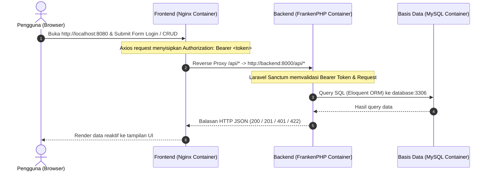

# UTS Konstruksi dan Evolusi Perangkat Lunak (KEPL)

**Sistem Manajemen Katalog Buku Perpustakaan (Library Management System)**  
Full-stack RESTful Application with Laravel (FrankenPHP), Vue.js, Docker Compose, & GitHub Actions CI/CD.

---

## 👤 Identitas Mahasiswa

- **Nama**: Muhammad Arief Andriansyah
- **NIM**: 24/545740/SV/25748
- **Program Studi**: Sarjana Terapan Teknologi Rekayasa Perangkat Lunak (TRPL)
- **Departemen**: Teknik Elektro dan Informatika, Sekolah Vokasi
- **Institusi**: Universitas Gadjah Mada

---

## 📌 Ringkasan Pengerjaan Soal UTS

| No | Materi Uji CPMK | Status | Deskripsi Singkat |
|---|---|---|---|
| 1 | **CPMK 1** (RESTful API Laravel) | ✅ Selesai | API Auth Sanctum (`/login`, `/logout`, `/user`) & CRUD Resource `books` (201 Created, 422 Unprocessable, 401 Unauthorized), 17 Feature tests lulus, Postman Collection tersimpan. |
| 2 | **CPMK 1** (Frontend Vue.js) | ✅ Selesai | SPA Vue 3 + Vite, Axios token interceptor, login view, full CRUD buku interaktif, dynamic env base URL (`VITE_API_BASE_URL`). |
| 3 | **CPMK 2** (Git & GitHub Actions CI) | ✅ Selesai | Repo publik `uts-pl-24-545740-SV-25748`, branch `main`, `dev`, `feature/book-crud-api-and-ui`, CI workflow `.github/workflows/ci.yml` (Backend test & Frontend build). |
| 4 | **CPMK 3** (Continuous Deployment) | ✅ Selesai | Job deploy otomatis build & push Docker image ke GitHub Container Registry (`ghcr.io`) dengan tag commit hash (`${{ github.sha }}`) hanya pada push ke `main`. |
| 5 | **CPMK 4 & 5** (Dockerfile & Best Practices) | ✅ Selesai | `backend/Dockerfile` dengan FrankenPHP & composer layer caching, `frontend/Dockerfile` multi-stage build Nginx tanpa `node_modules`, `.dockerignore`, zero hardcoded secrets. |
| 6 | **CPMK 6 & 7** (Docker Compose) | ✅ Selesai | 1-command startup `docker compose up -d --build`, 3 services (`database`, `backend`, `frontend`), reverse proxy internal network (`http://backend:8000`), persistent named volume `db_data`, `.env.example`. |
| 7 | **Bonus (+10)** (FrankenPHP) | ✅ Selesai | Server aplikasi backend menggunakan `dunglas/frankenphp:1.4.4-php8.3-bookworm` (modern Caddy + PHP in-process). |
| 8 | **Laporan Ujian** (Dokumentasi) | ✅ Selesai | Laporan lengkap pengerjaan, screenshot, alur data, kendala dan solusi (`LAPORAN_UTS_KEPL.md`). |

---

## 📁 Struktur Direktori Repositori

```text
uts-pl-24-545740-SV-25748/
├── .github/
│   └── workflows/
│       └── ci.yml               # Pipeline GitHub Actions (Test, Build, Deploy GHCR)
├── backend/                     # Backend Laravel 12 + Laravel Sanctum
│   ├── app/
│   │   ├── Http/Controllers/   # AuthController & BookController
│   │   └── Models/              # User & Book Models
│   ├── database/
│   │   ├── factories/           # UserFactory & BookFactory
│   │   ├── migrations/          # Migrasi users, personal_access_tokens, books
│   │   └── seeders/             # DatabaseSeeder (Admin demo & sample books)
│   ├── routes/
│   │   └── api.php              # RESTful API endpoints
│   ├── tests/
│   │   └── Feature/             # AuthApiTest & BookApiTest (17 feature tests)
│   ├── Caddyfile                # Konfigurasi FrankenPHP server
│   ├── docker-entrypoint.sh     # Container initialization script
│   ├── Dockerfile               # Production FrankenPHP image
│   └── .dockerignore
├── frontend/                    # Frontend Vue.js 3 + Vite
│   ├── src/
│   │   ├── assets/main.css      # Styling responsif UI
│   │   ├── router/index.js      # Vue Router navigation & auth guards
│   │   ├── views/               # LoginView & BooksView
│   │   ├── api.js               # Axios instance & token interceptors
│   │   ├── App.vue
│   │   └── main.js
│   ├── nginx.conf               # Nginx config with reverse proxy to backend
│   ├── Dockerfile               # Multi-stage Docker build
│   └── .dockerignore
├── .env.example                 # Template environment variables
├── .gitignore                   # Git ignore file (termasuk .env)
├── docker-compose.yml           # Orkestrasi 3 service (MySQL, FrankenPHP, Nginx Vue)
├── UTS_KEPL_API.postman_collection.json # Export Postman Collection lengkap
└── README.md
```

---

## 🚀 Panduan Menjalankan Sistem

### Opsi A: Menjalankan Seluruh Sistem dengan Docker Compose (Sangat Direkomendasikan)

Pastikan Docker Desktop sudah terpasang dan berjalan, lalu jalankan:

```bash
# 1. Salin template file environment jika belum ada
cp .env.example .env

# 2. Bangun dan jalankan seluruh container
docker compose up -d --build

# 3. Cek status container
docker compose ps
```

Akses aplikasi:
- **Frontend Web UI**: [http://localhost:8080](http://localhost:8080)
- **Backend API Direct**: [http://localhost:8000/api](http://localhost:8000/api)
- **Database MySQL**: `localhost:3306`

#### Kredensial Akun Bawaan (Database Seeder):
- **Email**: `admin@example.com`
- **Kata Sandi**: `password123`

---

## 🧪 Pengujian Sistem

### 1. Feature Tests Laravel (PHPUnit)
```bash
cd backend
php artisan test
```
*Hasil: 17 feature tests berhasil lulus (73 assertions).*

### 2. Pengujian Frontend Build
```bash
cd frontend
npm ci
npm run build
```
*Hasil: Bundle terkompilasi dalam folder `dist/` secara optimal.*

### 3. Pengujian RESTful API dengan Postman
Import file `UTS_KEPL_API.postman_collection.json` ke Postman:
1. Jalankan request **Auth > 1. Login - Success (200)**. Token Sanctum otomatis disimpan ke variabel `{{token}}`.
2. Jalankan request CRUD **Books Resource** (List, Create 201, Show, Update 200, Delete 200, Error Validasi 422, dan Unauthorized 401).

---

## 🔄 Aliran Data Antar Komponen (Data Flow)



---

## 🔒 Branch Protection & Git Workflow

- **Branch Utama**:
  - `main`: Branch rilis produksi. Deployment otomatis ke GHCR hanya berjalan di branch ini.
  - `dev`: Branch integrasi pengembangan.
  - `feature/book-crud-api-and-ui`: Branch implementasi fitur.
- **Aturan Perlindungan (Branch Protection)**:
  - Mewajibkan *Pull Request* sebelum merge ke `main` dan `dev`.
  - Mewajibkan status check GitHub Actions (`test-backend` dan `build-frontend`) bernilai **hijau (Passed)** sebelum Pull Request dapat digabungkan.
